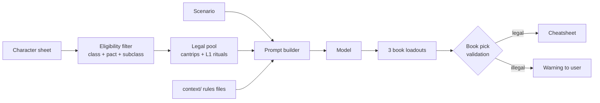

# What spellbook?

This project is designed to recommend spells to suit a scenario or encounter given a prompt and grounded in a ruleset and spell list.

The first proof-of-concept is for a D&D 5.5e (2024) Celestial Warlock with Pact of the Tome. Pact of the Tome enables rewriting of the spell-book after a short or long rest. And the class combo means spells can be selected from _any class_ if it has the [xxxx?] tag.

Given markdown (or similar) formatted spell lists, a character's level, and any other relevant information, and provided with a prompt (a scenario or encounter) it will recommend the cantrips and spells the new spellbook should contain, a rationale, and a cheatsheet of how to deploy them (possibly in combination with other prepared spells).

This project will store all settings in localstorage exportable to JSON and the cloud. The prompt and scenario history will be stored along with a rating from the player as to how well the recommendation performed (including an updated scenario or encounter prompt).

It will run as a webapp optimised for mobile. The interface should be minimal: character selection and storage, a history of scenarios, an editor for the character.

## Sources

5.5e SRD has 339 spells. DNDBeyond 400+ (includes legacy and trademarked spells).

https://github.com/downfallx/dnd-5e-srd-markdown/blob/master/spells.md
https://drive.google.com/drive/folders/16T2y1UaSgLQtEBWXmSU3zc0L7L6TKVT8
https://5e24srd.com/spells/spell-descriptions.html
https://toolsandtaverns.com/spells
https://dungeonmister.com/guides/classes-in-dungeons-dragons/celestial-warlock-dnd-2024-guide/
https://www.dndbeyond.com/classes/2190885-warlock#CelestialPatron

## Versions

### Front end

Framework: React + Vite
Status: not started. Planned in ARCHITECTURE and ROADMAP


### Backend

None as yet

### CLI

Framework: Python and langchain
Status: Testing in main.py

Run it with:

```bash
python main.py                      # loads data/characters/lois.yaml
python main.py --character vax      # loads data/characters/vax.yaml
CHARACTER=vax python main.py        # same, via environment variable
```

Character sheets are plain YAML in `data/characters/<name>.yaml`; keys are
rendered as `Key: value` lines for the prompt, and list values are joined with
commas.

### How a recommendation is built

Two stages, deliberately separated:



**Stage 1 — build a legal pool.** What a character may prepare is a *rules*
question, so the scenario is never allowed to widen it. Books of Shadows take
exactly 3 cantrips and 2 level 1 rituals, so both lanes are fetched
**exhaustively** from indexed metadata rather than by similarity search — a
vector search cannot be trusted to return all 48 cantrips. Levelled spells are
excluded from the pool entirely: a Warlock's prepared list does not change on a
short rest, so offering them only invited the model to mis-file them as picks.

**Stage 2 — let the model rank.** The scenario ranks the shortlist (deciding
which spells get their full text included) and drives the tactical write-up.

**Rules grounding.** `context/` is laid out as `context/[class]/[pact|subclass]/`
and injected by prompt builders, not hard-coded:

| Context file | Applies to |
| --- | --- |
| `context/spells.md` | Every character (casting economy) |
| `context/classes/warlock/base.md` | Any Warlock |
| `context/classes/warlock/pact/tome.md` | Pact of the Tome |
| `context/classes/warlock/subclass/celestial.md` | Celestial Patron |

Context files hold **rules only** and never a character's name or level; the
sheet holds the character's values. Development learnings live in `AGENTS.md`.

**Book pick validation.** After the model answers, every entry in each book's
cantrip and ritual lists is checked against the eligible pool. Models reliably
mis-file spells that appear in the rules context but not the pool — a Celestial
Warlock's always-prepared `Guiding Bolt` is the recurring example — and a wrong
book is only discovered at the table.

Tests:

```bash
pip install -r requirements-dev.txt
pytest
```

The suite covers `/slash` command parsing and TAB completion, character sheet
loading, spell parsing and eligibility rules, prompt assembly, the retrieval
lanes, and book-pick validation. It imports `main` but never builds a vector
index, contacts a model, or touches `data/chroma_db`.

- [x] Switch to /slash+TAB style commands like Claude CLI and Discord
- Add /test command
- Add /help command
- [x] Move character/s to JSON/YAML file in `data/characters`
- [x] Filter retrieval by what the character can legally prepare
- [x] Ground prompts in `context/` rules files
- Move remaining config to .env file

LLM backend: OpenRouter (`deepseek/deepseek-v4.1-flash-1017`) via `OPENROUTER_API_KEY` in a gitignored `.env`, falling back to local Ollama (`qwen3.5:4b`) when no key is present.

Note: `qwen3.5:4b` is a *thinking* model. It can spend its whole token budget on
internal reasoning and return an empty response, so the CLI reports an empty
completion as a failure rather than printing nothing. For local work a slightly
larger non-thinking model gives more reliable structured output.
