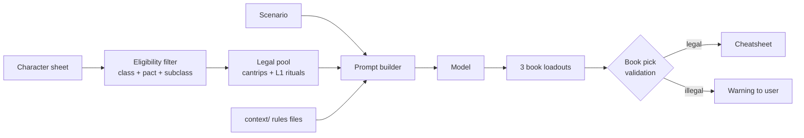

# What spellbook?

This project is designed to recommend spells to suit a scenario or encounter given a prompt and grounded in a ruleset and spell list.

The first proof-of-concept is for a D&D 5.5e (2024) Celestial Warlock with Pact of the Tome. Pact of the Tome enables rewriting of the spell-book after a short or long rest. And the class combo means spells can be selected from _any class_ if it has the [xxxx?] tag.

Given markdown (or similar) formatted spell lists, a character's level, and any other relevant information, and provided with a prompt (a scenario or encounter) it will recommend the cantrips and spells the new spellbook should contain, a rationale, and a cheatsheet of how to deploy them (possibly in combination with other prepared spells).

This project will store all settings in localstorage exportable to JSON and the cloud. The prompt and scenario history will be stored along with a rating from the player as to how well the recommendation performed (including an updated scenario or encounter prompt).

It will run as a webapp optimised for mobile. The interface should be minimal: character selection and storage, a history of scenarios, an editor for the character.

## Repository layout

A monorepo: one Python package and one npm project, side by side at the root.

```
backend/          the Python package
  libs/             rules, retrieval, prompting, caching - the domain, no printing
  cli/              the terminal front end
  api/              the HTTP front end
  __main__.py       `python -m backend` runs the CLI
frontend/         the npm project
  app/              the React source
context/          rules text injected into the model prompt
data/             character sheets and the Chroma index (untracked)
tests/            pytest
```

There is no `src/`. Nothing here compiles, so a `src/` root would only have meant inserting
`src/` onto `sys.path` so that `from backend import config` resolved - a directory's *name*
doing work its contents did not. The repo root is the import root instead, which is why
every import is written in full as `backend.libs.<module>`.

Within `backend/`, `libs` is the domain and `cli`/`api` are peers over it. The dependency
direction is one-way and a test enforces it: **`backend/libs` never imports `backend/cli`
or `backend/api`**. That is the whole reason the API could be added without touching the
recommendation logic.

## Sources

5.5e SRD has 339 spells. DNDBeyond 400+ (includes legacy and trademarked spells).

Rules text (`/?`) is grounded in the vendored SRD 5.2.1 Markdown under `context/srd/`,
which is CC-BY-4.0. See `context/srd/PROVENANCE.md` for attribution.

- https://github.com/downfallx/dnd-5e-srd-markdown/blob/master/spells.md
- https://drive.google.com/drive/folders/16T2y1UaSgLQtEBWXmSU3zc0L7L6TKVT8
- https://www.dndbeyond.com/srd
- https://toolsandtaverns.com/spells
- https://dungeonmister.com/guides/classes-in-dungeons-dragons/celestial-warlock-dnd-2024-guide/
- https://www.dndbeyond.com/classes/2190885-warlock#CelestialPatron

## Versions

### Front end

Framework: React + Vite + Tailwind v4 + shadcn-style components
Status: working — scenario, history, character and rules screens

```bash
cd frontend
npm install
npm run dev            # http://localhost:5173
```

The API must be running first (below). The dev server talks to `http://localhost:8000`
directly rather than proxying, because the API allows that origin explicitly — a proxy
would hide the CORS setup from the dev loop and only fail in a real deployment.
`VITE_API_BASE` overrides the address for a build.

Both ports are overridable, because more than one copy of each may be running on the same
machine. `VITE_PORT` moves the dev server and `FRONTEND_PORT` tells the API which origin to
allow; they must be set to the same value or the browser will block the request. `API_PORT`
is documentation only — uvicorn takes `--port` — and `CORS_ORIGINS` adds any further
origins as a comma-separated list.

```bash
VITE_PORT=5273 VITE_API_BASE=http://localhost:8100 npm run dev
API_PORT=8100 FRONTEND_PORT=5273 uvicorn backend.api.main:get_app --factory --reload \
  --reload-dir backend --reload-dir context --port 8100
```

The dev server is already live: Vite replaces a changed module in place, so an edit to
anything under `frontend/app/` appears without a reload and without losing the scenario
typed into the form. Only the API needs the flag, and only because uvicorn does not watch
by default.

`.vscode/tasks.json` starts both, one terminal each, with `⌘⇧B`. The pairs are `Vite: dev`
and `API: dev` for the default ports, and `Vite: dev (5273)` and `API: dev (8100)` for a
second copy running alongside someone else's.

The one thing the UI is careful about: an answer's `source` is always visible. A `sheet`
answer is read verbatim from the character file and cannot be wrong, a `model` answer is
generated and can be, and a `rules` answer is quoted from the 2024 SRD. Showing one as
another would let a plausible guess look like a recorded fact.

### Backend API

Framework: FastAPI + uvicorn
Status: working

```bash
uvicorn backend.api.main:get_app --factory --reload \
  --reload-dir backend --reload-dir context --port 8000
```

`--reload` is what makes the API live: an edit to a module under `backend/` restarts it
within about a second, and the front end picks up the new routes on its next request with
no restart of its own. The two `--reload-dir` flags matter more than they look. Without
them uvicorn watches the whole repository, and `.cache/` is written on *every run* — so
each generated book would restart the server, terminating the request that was writing it.
Watching `context/` as well means editing a vendored SRD file or a class context file takes
effect without a manual restart, which is the other half of the rule text this app reads.

Interactive docs are at `http://localhost:8000/docs`. The API contains no logic: every
route validates its input, calls one `SpellbookService` method, and maps the result or a
typed error to a status code. That is what keeps the CLI and the API from drifting apart.

| Endpoint | Purpose |
| --- | --- |
| `GET /api/health` | Liveness, loaded model, index version |
| `GET /api/characters` | Sheet names on disk, for a picker |
| `GET /api/character` | The loaded sheet |
| `GET /api/character/ask?question=` | The `/c` command |
| `GET /api/sheet-keys` | Every value `/c` can look up |
| `POST /api/scenario` | Generate, or replay the stored run for the same key |
| `GET /api/cached?scenario=` | The stored run, or `null` — a miss is not an error |
| `POST /api/ask?scenario=` | The `/ask` command |
| `GET /api/history` | Every stored run, newest first |
| `GET /api/runs/{id}` | One run reopened for reading |
| `POST /api/runs/{id}/rate` | Record an outcome rating |
| `GET /api/rules?question=` | The `/?` command, grounded in the 2024 SRD |
| `GET /api/spell?name=` | One spell's description, for every spell mention in the UI |
| `GET /api/invocation?name=` | One Eldritch Invocation, from the SRD's class chapter |
| `GET /api/spells` | Every name the UI should link — spells and invocations |

Errors are mapped deliberately, because the distinction a client acts on is whether
retrying could help:

| Exception | Status |
| --- | --- |
| `ValueError` | 400 — bad input the caller can fix |
| `CharacterNotFound`, `RulesUnavailable` | 404 |
| `CharacterNotLoaded` | 409 |
| `NoEligibleSpells` | 422 — the rules allow no picks; retrying is pointless |
| `EmptyCompletion` | 502 — the model returned nothing; retrying may help |
| `LLMUnavailable` | 503 |

A run is identified by an opaque `id` (the cache directory name), never by a filesystem
path: a browser cannot use a server path, and publishing the cache layout leaks
information for no gain. Reopening also accepts a scenario fragment, so a caller that
already knows what it wants can skip the listing.

`POST /api/scenario` and `GET /api/runs/{id}` both return that `id` as `run_id`, and it is
the only handle a client should rate with. Rating by scenario text is ambiguous, because a
run is keyed on the scenario *and* the character, level and book count — two runs can share
a scenario, and the wrong one gets rated.

### CLI

Framework: Python and langchain
Status: working

Run it with:

```bash
python -m backend                  # loads data/characters/lois.yaml
python -m backend.cli              # same thing, spelled differently
python -m backend --character vax  # loads data/characters/vax.yaml
CHARACTER=vax python -m backend    # same, via environment variable
BOOKS=2 python -m backend          # generate 2 alternatives instead of 3
python -m backend --refresh        # ignore cached books, regenerate everything
```

Run from the repo root: the imports are `backend.*`, so the root is the import root. There
is deliberately no `python backend/app.py` - running a file directly puts *its own*
directory on `sys.path`, so that command can never work, and a launch form that crashes is
worse than one that does not exist.

Character sheets are plain YAML in `data/characters/<name>.yaml`; keys are
rendered as `Key: value` lines for the prompt, and list values are joined with
commas.

While it works, the CLI reports each stage and styles the answer:

```
... Fetching spells from the grimoire... (~2.5s)
    done: Fetching spells from the grimoire (2.5s)
... Crafting the prompt... (~0.2s)
    done: Crafting the prompt (0.2s)
... Scribing the Books of Shadows... (~68.5s)
    done: Scribing the Books of Shadows (1m 08s)
```

Each stage is timed, and once a couple of runs are stored the typical duration of each
is known, so a running stage advertises roughly how long it will take. With no history
no estimate is invented. After each run the timings are logged, both for that run and
across all runs. See [Timings](#timings).

Headings, bold and lists are rendered rather than shown as raw markdown, and the
styling is skipped automatically when output is redirected.

### Layout

```
backend/libs/   rules, retrieval, prompting, caching, index, watcher, lookup, timing
backend/cli/    REPL, arguments, progress, markdown rendering
backend/api/    FastAPI routes and wire schemas
frontend/app/   React UI calling the API
```

The rule that keeps the split honest: **`backend/libs` never imports `backend/cli` or
`backend/api`**. `backend.libs.service.SpellbookService` is the seam — it does the work and
returns `Generation`/`Book`/`Answer` dataclasses, and never prints, prompts or exits.
The REPL renders those objects; the API serialises the same ones. A test asserts the
layering holds, so a rule that leaked into a transport layer would fail the suite rather
than quietly existing in only one front end.

### How a recommendation is built

Two stages, deliberately separated:



**Stage 1 — build a legal pool.** What a character may prepare is a *rules*
question, so the scenario is never allowed to widen it. Books of Shadows take
exactly 3 cantrips and 2 level 1 rituals, so both lanes are fetched
**exhaustively** from indexed metadata rather than by similarity search — a
vector search cannot be trusted to return all 48 cantrips. Levelled spells are
excluded from the pool entirely: a Warlock's prepared list does not change on a
short rest, so offering them only invited the model to mis-file them as picks.

**Stage 2 — let the model rank.** The scenario ranks the shortlist (deciding
which spells get their full text included) and drives the tactical write-up.

**Rules grounding.** `context/` is laid out as `context/[class]/[pact|subclass]/`
and injected by prompt builders, not hard-coded:

| Context file | Applies to |
| --- | --- |
| `context/spells.md` | Every character (casting economy) |
| `context/classes/warlock/base.md` | Any Warlock |
| `context/classes/warlock/pact/tome.md` | Pact of the Tome |
| `context/classes/warlock/subclass/celestial.md` | Celestial Patron |

Context files hold **rules only** and never a character's name or level; the
sheet holds the character's values. Development learnings live in `AGENTS.md`.

**Book pick validation.** After the model answers, every entry in each book's
cantrip and ritual lists is checked against the eligible pool. Models reliably
mis-file spells that appear in the rules context but not the pool — a Celestial
Warlock's always-prepared `Guiding Bolt` is the recurring example — and a wrong
book is only discovered at the table.

**Spells the character already has.** A sheet spreads them across several fields,
so they are read as a union: Warlock picks, the patron's always-prepared list,
species and feat cantrips, and free casts. The book cannot duplicate anything the
character already has, so all of them are excluded from the pool and listed
explicitly in the prompt. The book's *current* loadout is deliberately **not**
excluded — the book is conjured fresh each rest, so re-picking remains legal.

### Result cache and ratings

A run is written to `.cache/` before it is printed, and a repeat of the same
scenario is then served straight from disk — no embedding call, no prompt
assembly, no model call:

```
.cache/
└── lois/
    └── 5-barbarian-fighter-druid-3-098f6d563801/
        ├── run.json                      # shared: sheet, context, prompt, response
        ├── 1-illuminated-kill-zone.json  # one book: its markdown, picks, rating
        ├── 2-ambush-breaker.json
        └── 3-bridge-hold-defense.json
```

The directory path _is_ the cache key: character, level, party, database version,
and a hash of the scenario. A rebuilt index (`INDEX_VERSION`) lands in a new
directory, so stale entries can never be mistaken for current ones.

**Shared inputs are stored once.** The prompt, sheet and pool are identical across
the three books, so they live in `run.json` rather than being copied into each book
(~47KB once instead of three times). **Each book gets its own file** because a book
is the unit of rating, so rating one never rewrites its siblings.

A hit requires the *whole* key plus a fingerprint of the character sheet, so editing
the sheet between runs regenerates instead of replaying advice for a character that
no longer exists. Cached answers are re-validated against the eligibility rules
rather than trusted, since an entry may predate a rules change. A partial directory
(a hand-deleted book) is treated as a miss, so you never see fewer books than the
model produced.

```json
// run.json — written once per run
{ "key": { "character": "lois", "level": 5, "party": "barbarian-fighter-druid",
           "db_version": 3, "scenario": "098f6d563801",
           "scenario_text": "We are ambushed crossing a narrow stone bridge at night.",
           "character_fingerprint": "1f3c…" },
  "prompt": { "prompt": "..." },
  "response": "...",
  "context": { "pool_cantrips": ["..."], "rule_context_files": ["spells.md"] } }

// 1-illuminated-kill-zone.json — one per book, the unit of rating
{ "run": "run.json",
  "output": { "book_index": 1, "book_name": "Illuminated Kill Zone",
              "picks": { "cantrips": ["Mind Sliver"], "rituals": ["Alarm"] } },
  "rating": { "score": null, "rated_at": null, "notes": null, "outcome": null } }
```

```bash
/rate 5                  # rate every book from the latest answer
/rate 4 bridge denial    # rate one book by name fragment
/history                 # list cached runs, newest first, numbered
/read 2                  # open run 2 from that listing and print its books
/read bridge denial      # same, by a fragment of its scenario
python -m backend --refresh # ignore the cache, regenerate every scenario
```

A rating is attached to a book _slot_ and carried across a regeneration, so a
`--refresh` that renames all three books does not discard the scoring you already
did. Because the prompt and response are stored alongside the rating, a rated book
is labelled training data: it records what was asked, what was suggested, and how
well it actually went.

`/history` lists **runs**, not books, because a book is ambiguous on its own — reading
one means reading the scenario it was written for. Each run is numbered so `/read <n>`
reopens it without typing a path, and `/read` restores the current answer, so `/rate`
and the legality warnings work exactly as they do after a fresh generation.

### Timings

Each run records how long its three phases took, in `run.json`:

```json
"timings": {
  "phases": { "retrieval": 2.558, "prompt": 0.0, "books": 38.379 },
  "total_seconds": 40.937,
  "unaccounted_seconds": 0.0
}
```

Per phase rather than one number, because they fail independently and want different
fixes: retrieval embeds the scenario locally, prompting is CPU work, and the model call
is network-bound. `unaccounted_seconds` is whatever the phases do not explain — if that
grows, the measurement is missing something rather than the work being free.

Two choices worth knowing when reading the numbers:

- **The estimate is a median over a short recent window** (5 runs), not the last value and
  not the whole history. A single sample is fragile — one rate-limited run skews every
  estimate after it until the next run lands (observed live: an estimate of `~1m 08s` for
  a run that took `43.2s`). A median over the recent window shrugs off one outlier while
  still following a real trend such as a model change. `median_seconds` is also reported
  across all runs for context.
- **A missing phase is kept, not discarded.** A run that died in the model call still
  has a valid retrieval time.

Phase names are shared with `backend/timing.py`; renaming one in the service without
renaming it there yields an empty breakdown rather than an error, which is why
`test_phase_names_match_the_service_and_the_labels` exists.

### Number of books

`BOOKS` sets how many Book of Shadows loadouts to ask for (1–9, default 3). It is not a
rules number — a book holds 3 cantrips and 2 level 1 rituals and is _one_ loadout per
short rest, so this is how many alternatives to compare. Each one lengthens the answer
and the wait.

```bash
BOOKS=2 python -m backend      # two alternatives, roughly two thirds of the output
```

The count is part of the cache key, so asking for two is a different request from asking
for three and will not replay a stored three-book run. An out-of-range or non-numeric
value is clamped with a warning rather than failing the run — a typo in an untracked
`.env` should not cost you a scenario.

Tests:

```bash
pip install -r requirements-dev.txt
pytest
```

657 tests. The suite covers `/slash` command parsing and TAB completion, character
sheet loading, spell parsing and eligibility rules, prompt assembly, the retrieval lanes,
book-pick validation, the result cache, the service layer, sheet and rules lookup, timing
aggregation, every API endpoint and its error mapping, and terminal rendering/progress.
It never builds a vector index, contacts a model, or touches `data/chroma_db`; anything
that writes is redirected to a temp directory.

Three tests guard structure rather than behaviour, because these are the failures that
would otherwise go unnoticed:

- `backend` imports without `cli` or `api`, so the layering stays intact.
- The CLI turns a missing character into an exit code, so the library stays
  exception-based.
- The API's error mappings hold. A wrong status code is a contract bug the front end
  hits, and testing the service directly cannot catch it.

Where a fake would hide the thing under test, the real path is kept. The rules cache test
stubs only the model call: replacing `gather`, or the file reader beneath it, would replace
the cache lookup the test exists to verify. Stubbing the corpus is worse than useless - it
changes the term-frequency model the matcher ranks headings with, so the test asserts
whatever a one-line fake SRD implies rather than what the real one does.

- [x] Switch to /slash+TAB style commands like Claude CLI and Discord
- Add /test command
- [x] Add /help command
- [x] Move character/s to JSON/YAML file in `data/characters`
- [x] Filter retrieval by what the character can legally prepare
- [x] Ground prompts in `context/` rules files
- [x] Move remaining config to .env file (`CHARACTER` and `LLM_MODEL` are wired; paths are not)
- [x] Cache input, context, and responses so we can learn from the previous outputs
- [x] Reuse the cache when the character and scenario are unchanged
- [x] Rate a generated book after the scenario is played
- [ ] Report on rating patterns once enough books are rated
- [ ] Add /character command to switch characters
- [x] Refactor `main.py` and supporting files into a proper class/module structure so it can power both the CLI and a front end via an API. Pulled the CLI functions out into their own layer and noted the design in AGENTS/ROADMAP.
- [x] Expand the CLI to have progress meter like Claude: fetching spells from Grimoire, crafting prompt, scribing Books of Shadow. When printing markdown to the console please format it rather than raw markdown. Bold, italics, headings could be coloured.
- [x] Add a command to ask anything about a character: rule clarification, reason why they have two spells the same, how their stats are being boosted. Could extend to simple retrieval of a roll eg: /c perception (should return a number from a character sheet) or /? short rest (looks up the rules online and caches the answer).
- [x] Build the React/Vite/Tailwind/shadcn front end
- [x] Create the backend API
- [x] The rules lookup button should be an icon and shouldn't wrap the text.
- [x] Each mention of a spell should open the rules tab and display the spell from the vendored repo
- [x] Read books should look like a button with a carat
- [ ] Restructure the book prompt: fold the item pairings into each book, make the
      invocations one run-level line, promote the gotchas into their own block. Section 4
      is ~38% of all prose and its invocation half repeats identically in every book.
- [x] when the read books is open it should show all the content--so grid is probably the wrong thing to do .. Use flex and flex wrap probably and the open one should be full width.
- [x] Opening in the scenario screen should show the results as well as the prompt.
- [ ] When reading a book open clicked local context spell descriptions in a pull out drawer.Keep the original link so that CTRL CLICK still opens in a new tab but add an onclick handler to trigger the drawer (for local links).
- [ ] The pull out drawer of spells should have a search box at the top to search all spells.
- [ ] Highlighting a piece of text should bring up a contextual window with search in it. Search should use RAG to find out what the selected text means in context of the game.
- [ ] Percentage (in timing) shouldn't stop at 99% if the process is running longer.
- [ ] When showing spells or other information contextualise it to the current character: Goodbye, Warlock should be Goodbye Louis, Eldritch blast should show "2 beams (L5)"
- [x] Spells display parsing: Expand Components to their full meaning (V, S, D, M), add Damage (if any) to the description at the top next to Casting time, add icons to duration, casting time, damage, components, range.
- [ ] Asking a question in the rules search like "explain the initiative system to me like I'm 12yo" should respond with a generative answer based on the rules if it can't find a precise rule not "The 2024 SRD has no section matching 'explain the initiative system to me like I'm 12yo'. The SRD covers the core rules, not every option in the Player's Handbook."
- [ ] When you press the "read books" button it flashes some other text briefly (Open something) and then flips back only changing the caret. It should say something like "hide books".
- [ ] We have 'Fetching spells from [the] Grimoire' in multiple places. It should be a const or enum.

### Choosing the model

`LLM_MODEL` in `.env` selects the reasoning model for both backends. Which backend it
means is inferred from the name, because the two conventions are unambiguous — an
OpenRouter id is `vendor/model` (contains `/`), an Ollama name is `name:tag` (does not):

| `LLM_MODEL` | Backend used |
| --- | --- |
| unset, `OPENROUTER_API_KEY` set | OpenRouter, `deepseek/deepseek-v4.1-flash-1017` |
| unset, no key | Ollama, `qwen3.5:4b` |
| `deepseek/deepseek-v4.1-flash-1017` | OpenRouter |
| `qwen2.5-coder:7b-instruct` | Ollama — **even with a key present** |

That last row is the point: it lets a key stay in `.env` for occasional use while
running locally by default. A remote model id with no key falls back to Ollama and says
so, rather than silently swapping models.

```bash
LLM_MODEL=qwen2.5-coder:7b-instruct python -m backend   # local, one-off
LLM_MODEL=openai/gpt-4o-mini python -m backend          # OpenRouter, one-off
```

`OLLAMA_MODEL` also overrides the local default (`qwen3.5:4b`) when `LLM_MODEL` is unset.
The embeddings model stays on Ollama regardless — `nomic-embed-text` is local-only.

Note: `qwen3.5:4b` is a _thinking_ model. It can spend its whole token budget on
internal reasoning and return an empty response, so the CLI reports an empty
completion as a failure rather than printing nothing. For local work a slightly
larger non-thinking model gives more reliable structured output
(`LLM_MODEL=qwen2.5-coder:7b-instruct`).
